# Kiler

[](https://github.com/g-stoyanov/Kiler/actions/workflows/ci.yml)

A stash for the things you need to find fast and don't want to keep in your head: passwords and accounts, addresses and links, notes and how-tos, code and snippets. For you, your family or your team, in a shared folder, with the private parts encrypted. One exe, with no installer, no central server and no database.

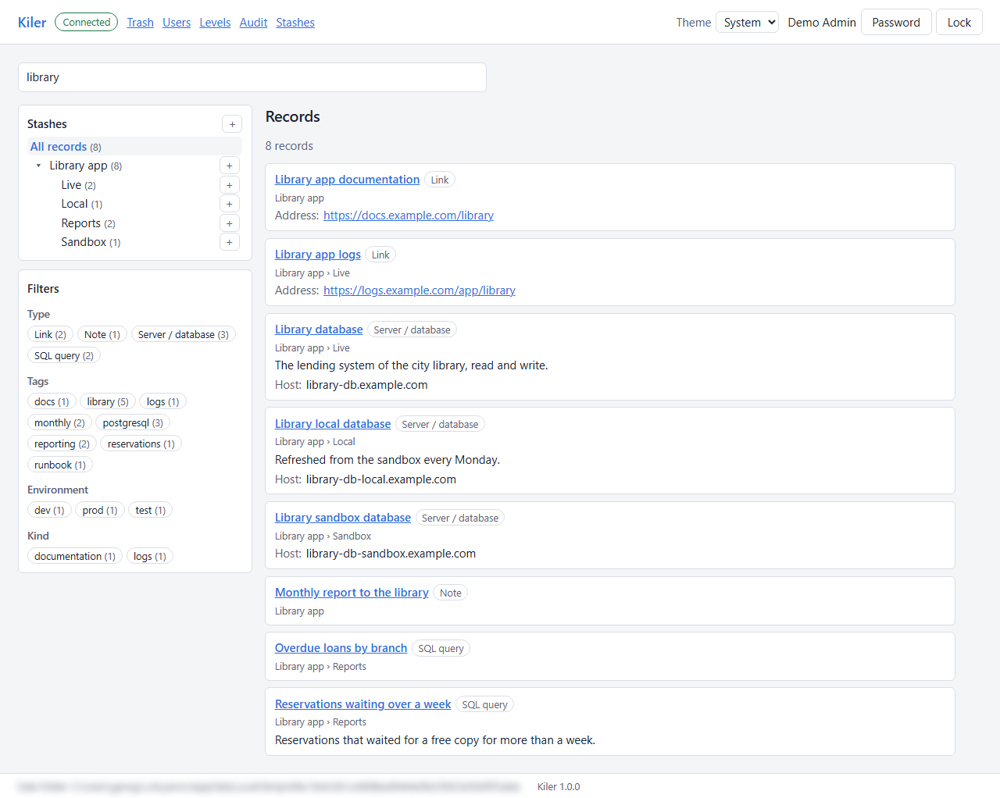

## What Kiler is

The small things that everyone needs again and again (the Wi-Fi password, the account of a website, a phone number, a recipe, the steps of a task that comes once a month, a link, a piece of code) end up on sticky notes, in text files and in chats, and nobody finds them when they are needed. Kiler keeps them in one place, as records in a tree of stashes up to four levels deep, such as `Home › Wi-Fi` or `Work › Reports`, and finds them as you type.

Each record is made from a template, which gives it its fields. Kiler 1.0 comes with five:

- **Note**: any text, such as a how-to, a list or a recipe;
- **Link**: a web address, on the internet or in your own network;
- **Server / database**: an address with a user and a password, such as a Wi-Fi router, a website or a database;
- **SQL query**: a query, linked to the database it runs in;
- **Snippet**: code in PowerShell, bash, Python, Java, JSON, XML, YAML or SQL, or plain text.

In 1.0 the templates are fixed; templates of your own come after it.

Every field has an access level. The fields of level 0 are open to anyone who can open the shared folder. The others are encrypted, and only a user who holds that level can read them; everyone else sees a padlock.

## Features

- **Find quickly.** Search as you type over all the records, filter by type, tag and field values, or browse the tree of stashes with the count of records in each.
- **Access levels.** The levels and their names are chosen at the setup (the demo has Public, Internal, Confidential and Secret). A user holds the levels up to theirs; a field above them shows a padlock. A password is shown only on request and hides again after 30 seconds, and "Copy" copies it without showing it.
- **Links between records.** A record can point to another, such as a query to the database it runs in.
- **Audit.** Every show and copy of a password at the top level is recorded in the shared folder, and an admin reads the log in the audit screen. While the log cannot be written, such a password is not given. Anyone who can write the shared folder can change its files too, so the log is for tracing, not proof.
- **Code and snippets.** Code is highlighted in its language, which a snippet picks from a list: PowerShell, bash, Python, Java, JSON, XML, YAML and SQL. "Copy" copies it whole. "Format" formats a SQL query, and "Parameters" finds its bind variables (`:branch`), takes a value for each and copies the query filled in.
- **History and trash.** Every change of a record is kept with who made it and when, and an old version can be restored. A deleted record goes to the trash, and back from there.
- **Many users at once.** The changes of the others show up without a reload. When two users edit the same record, the later save stops and shows the two versions side by side, with the differences marked: keep yours, or take theirs.
- **Users and stashes.** An admin adds users with a temporary password, which each changes at the first sign-in, gives each a level and the right to edit or to administer, renames the levels, and renames, merges and deletes stashes.
- **Guest mode.** When it is turned on at the setup, the open fields can be read without signing in.
- **Safe by default.** Kiler locks itself after some minutes without activity, stops when the last tab of it closes, and listens only on `127.0.0.1`.
- **Light and dark theme**, or the one of the system.

## How it works

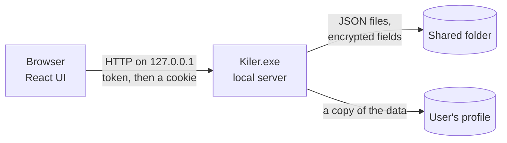

- **A local server and the browser.** `Kiler.exe` starts a small web server on `127.0.0.1`, at a free port, and opens the default browser at it with a random token in the address. Kiler exchanges the token for an HttpOnly cookie, so a program on the machine that does not have the token cannot use the server. A second start of Kiler opens the browser at the server that is already running. When the last tab closes, Kiler stops.
- **The shared folder.** The data is JSON files in `data\` beside the exe, one per record, stash, template and user. A write is atomic (a temporary file, then a rename), and it goes through only over the version that the user read, so two users never overwrite each other. The old versions go to `history\` and the deleted records to `trash\`. Kiler keeps a copy of the data in the user's profile, so it opens quickly, follows the changes in the folder, and can still be read when the shared folder cannot be reached.
- **Encryption by level.** Each access level above 0 has a random 256-bit key, and the fields of that level are encrypted with AES-256-GCM. A user's file holds the keys of their levels, locked with a key derived from their password (PBKDF2-SHA256, 600,000 iterations). The keys are unlocked only in memory, at sign-in, and dropped at the lock. The setup wizard also makes a recovery key, shown once, which locks all the level keys too.
- **Who is who.** The Windows account picks the user, and the user's password unlocks their levels.

## Screenshots

| | |
|---|---|
| 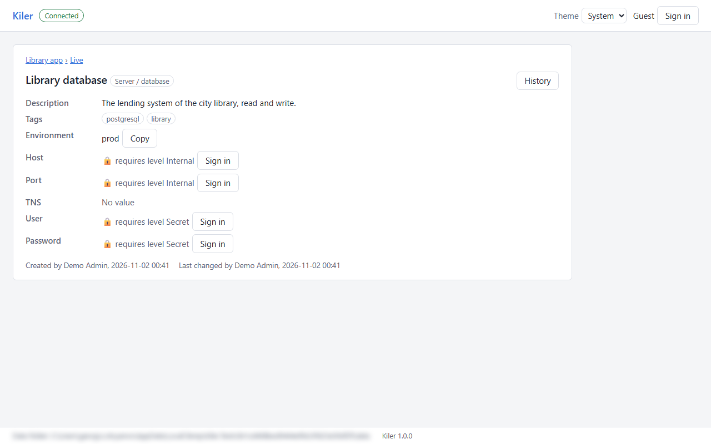<br/>A record as a guest: the fields above its level show a padlock | 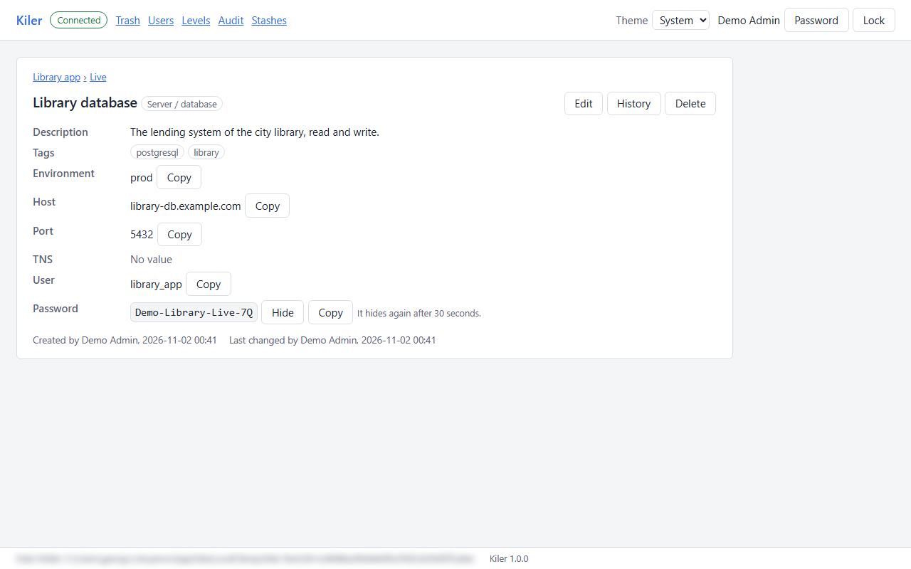<br/>The same record signed in, with its password shown |
| 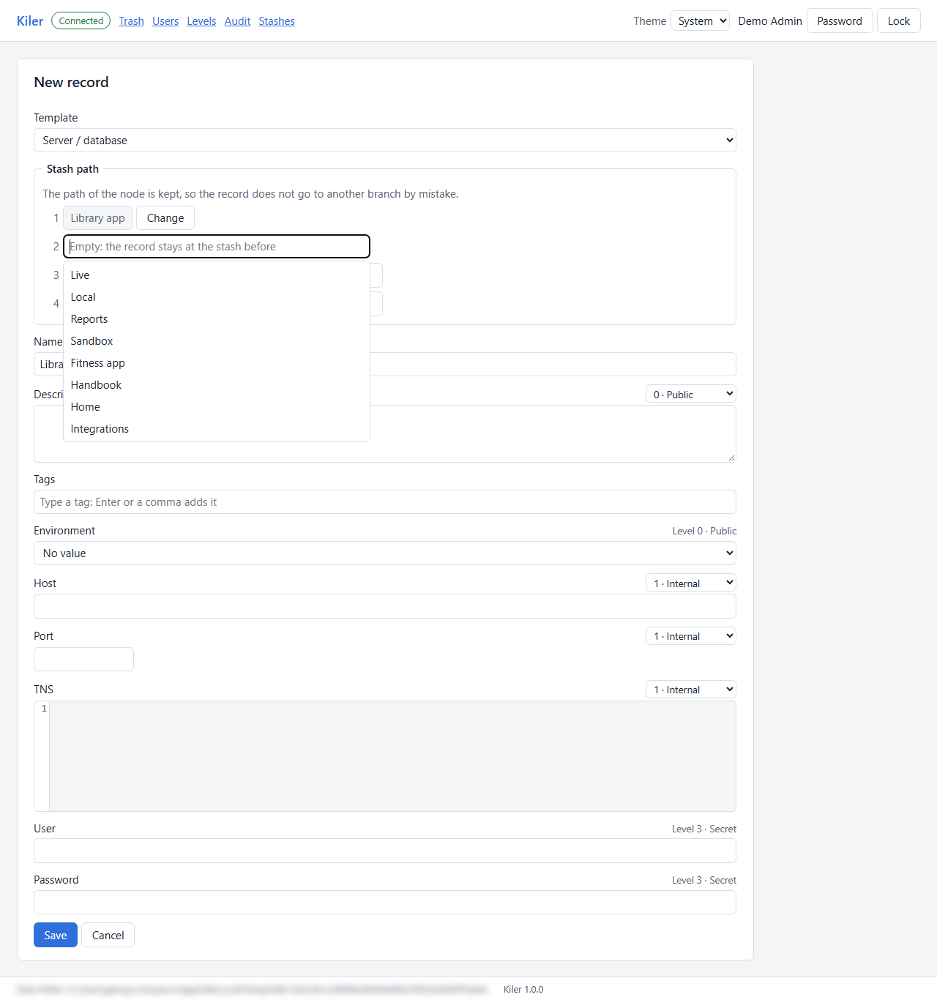<br/>A new record, with the stash picker | 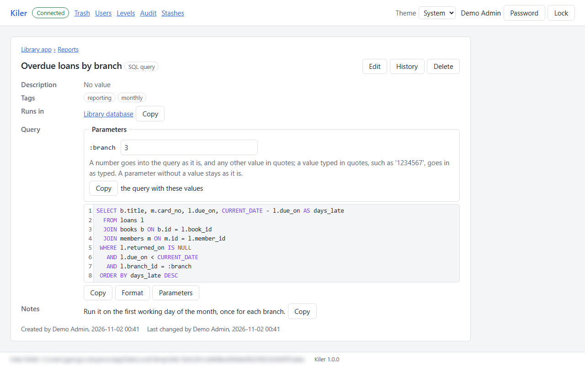<br/>A SQL query with "Parameters" |
| 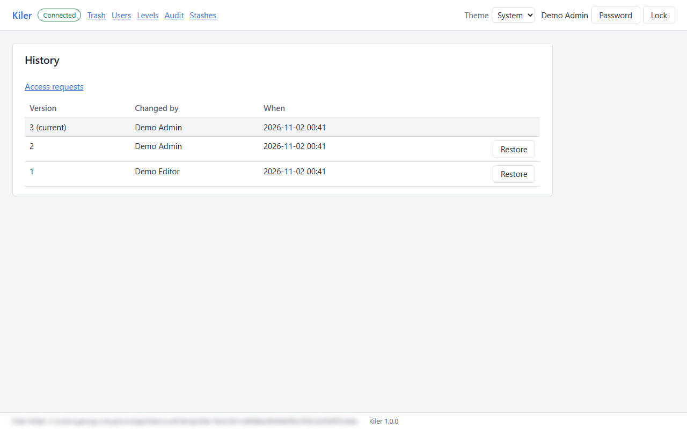<br/>The history of a record changed by two users | 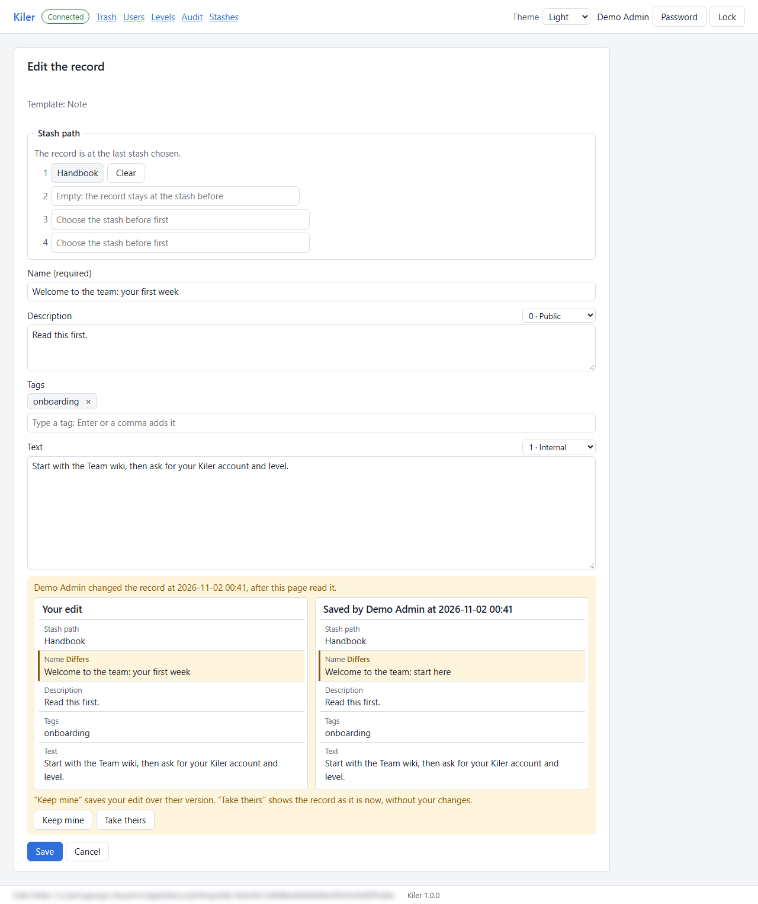<br/>A conflict: the two versions side by side |
| 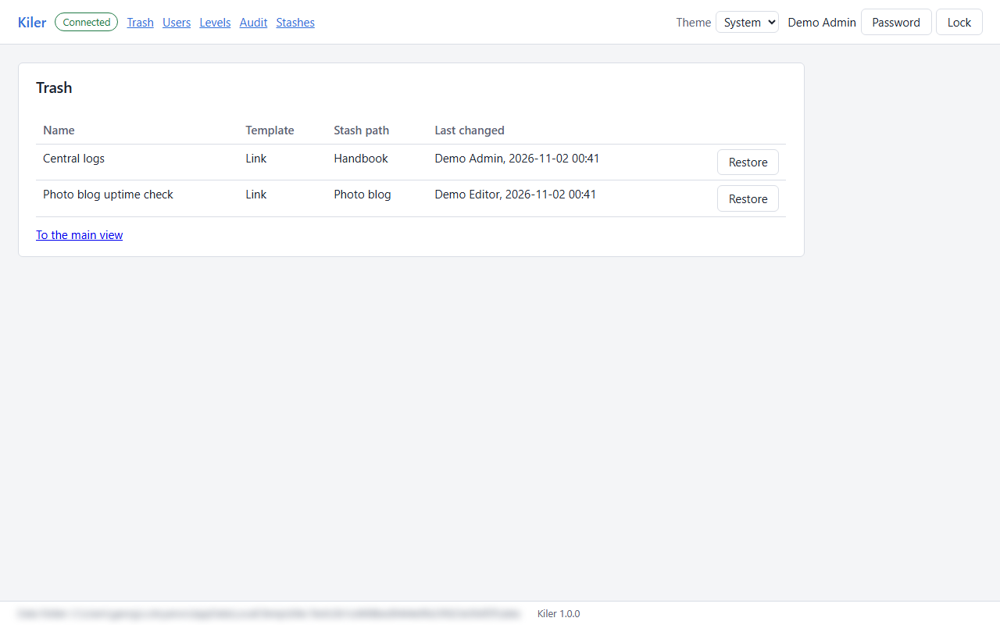<br/>The trash | 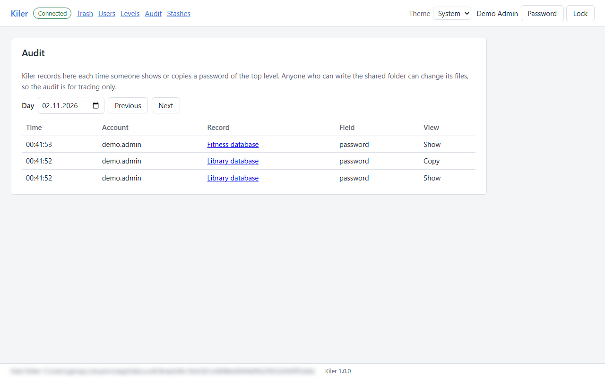<br/>The audit of a show and a copy of a password |
| 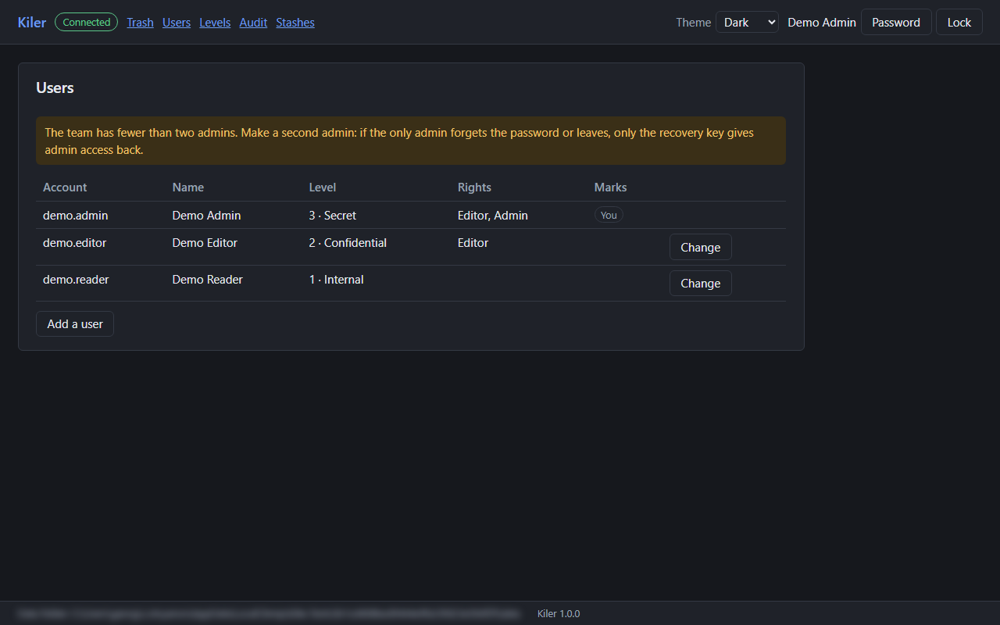<br/>The users, in the dark theme | 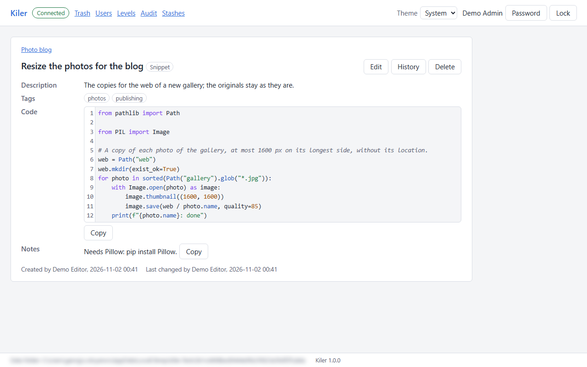<br/>A snippet in Python, highlighted |

The screenshots come from the E2E tests (`ScreenshotTests`), on the made-up demo data. The data folder at the foot of each page is blurred, as its path holds the Windows account of the machine.

## Technologies

| Part | Technologies |
|---|---|
| Server | .NET 10, ASP.NET Core minimal API on Kestrel, published with Native AOT as one `win-x64` exe that needs no .NET runtime |
| UI | React 19, TypeScript, Vite, React Router, CodeMirror 6, sql-formatter; the build is embedded into the exe |
| Cryptography | .NET's `AesGcm` and PBKDF2 |
| Tests | xUnit v3 on Microsoft Testing Platform, API tests on the real Kestrel, Vitest, Playwright for .NET |
| CI | GitHub Actions on `windows-latest`, through the same scripts as on the developer machine |

## Getting started

### Requirements

- Windows x64.
- The .NET 10 SDK (10.0.400 or a newer feature band, see `global.json`).
- Node.js 24.15 or newer.
- For the publish (Native AOT): the Visual Studio C++ build tools, the workload "Desktop development with C++".

### Build and test

The scripts are in the root of the repository. Where the execution policy asks for signed scripts, run each as `powershell -ExecutionPolicy Bypass -File .\<script>.ps1`.

```powershell
.\format.ps1          # the format check of the .NET code (dotnet format Kiler.slnx fixes it)
.\check-ui.ps1        # the UI: Prettier, ESLint, the type check and Vitest
.\build.ps1           # the Release build, with the UI built and embedded
.\test.ps1 -NoBuild   # all the .NET tests, with the coverage report in TestResults\coverage-report
.\publish.ps1         # Kiler.exe alone in artifacts\publish
.\smoke.ps1           # the smoke tests of the published exe
.\e2e.ps1             # the E2E tests of the published exe in Chromium; screenshots in artifacts\screenshots
```

The first run of `e2e.ps1` downloads Playwright's Chromium. CI runs the same scripts, in this order, on every push to `main` and every pull request.

### Run the demo

The demo is a made-up Kiler with work and personal notes: two projects at work, the home with its router and server, a photo blog and a handbook, 36 records at all four access levels. Make it, then start the exe of `publish.ps1` on it:

```powershell
dotnet run --project tools\Kiler.DemoData -- dev-data
.\artifacts\publish\Kiler.exe --data dev-data --account demo.admin
```

`--account` picks the demo user instead of the Windows account. Guest mode is on, so Kiler opens as a guest; "Sign in" in the header asks for the password.

| Account | Level | Rights | Password |
|---|---|---|---|
| `demo.admin` | 3 Secret | admin, editor | `admin-demo` |
| `demo.editor` | 2 Confidential | editor | `editor-demo` |
| `demo.reader` | 1 Internal | reads only | `reader-demo` |

`--replace` makes the demo again over a `dev-data` that is there (stop the Kiler that runs on it first), and `--volume` makes 2000 records.

To work on the UI, run it in dev mode instead, after `check-ui.ps1` has installed the packages. It starts Kiler with `dotnet run` on `dev-data` and the Vite dev server in front of it (where the execution policy blocks `npm.ps1`, use `npm.cmd`):

```powershell
cd src\ui
npm run dev -- --account demo.admin
```

### Start using it

1. Put `Kiler.exe` into a network folder that everyone who uses it can read and write (a UNC path or a mapped drive), such as a folder on the file server at work or on a NAS at home.
2. Each user starts it once from there. Kiler copies itself to `%LOCALAPPDATA%\Programs\Kiler`, adds Kiler to the Start menu, remembers the shared folder, and starts the copy. From then on, Kiler starts from the Start menu.
3. At the very first start `data\` is not there yet, so the setup wizard runs. It makes `data\` beside the exe, with the levels and the admin, and shows the recovery key once: keep it somewhere safe (restoring access with it comes after 1.0).
4. The admin adds the users, each with a temporary password, which the user changes at the first sign-in.

## Repository layout

```
src/
  Kiler.Crypto/        the cryptography, with no dependencies
  Kiler.Storage/       the files in the shared folder: atomic writes, versions, history, trash, the local copy
  Kiler.Core/          templates, records, search, users, permissions, audit
  Kiler.App/           Kiler.exe: the local server, the API and the Windows parts
  ui/                  the React UI, embedded into Kiler.exe
tools/Kiler.DemoData/  the made-up demo data
tests/                 the tests of each project, and Kiler.E2E with Playwright
docs/                  the plan, the API, the tasks and the screenshots
.claude/               the Claude Code skills, subagents and hooks of the project
```

## Status

Kiler 1.0 is the exam project of the course "AI-Assisted Development" at SoftUni, built with [Claude Code](https://claude.com/claude-code).

The project's skills, review subagents and hooks are in `.claude/`, and the work went by the plan in [docs/PLAN.md](docs/PLAN.md) and the tasks in [docs/tasks/](docs/tasks/README.md). The API is described in [docs/api.md](docs/api.md).

Some parts of the design come after 1.0, among them signed updates of the local copy (until then a new version is installed by hand), restoring admin access with the recovery key, private records with a personal key, the admin seal, the template screen, and Markdown documents with diagrams. The list is in [docs/PLAN.md, section 10](docs/PLAN.md#10-deferred-until-after-the-exam).
